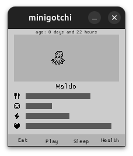

# Minigotchi
This is a very small desktop [Tamagotchi](https://en.wikipedia.org/wiki/Tamagotchi) built using the
[**macroquad**](https://macroquad.rs/) crate. Your pet starts as an egg, but hatches quickly. In
order to take care of you pet you should interact with it, but you should also give your pet the
rest it deserves.

*The `README.md` does not explain the game's mechanics. To learn about those read: ["How to play"](HOWTOPLAY.md).*




## Description

Minigotchi is a compact virtual pet intended to run on the desktop. It runs in a very small window and
can run as a standalone executable since all sprites are embedded in the software. The basic idea of the
game is to take care of a virtual pet by interacting with it once every now and then. The game stores its
state to disk as a single `minigotchi.sav` file, and uses **system time** for keeping track of the passage of time.


## Features

- Creature lifecycle
- Multiple different creatures to pick
- Creature personalities
- Ability to gain *trust* from your pet, which might be helpful...
- Multiple customization items.
- Feed, play and care actions
- Animated actions and simple movement behaviors
- Persistent save file written next to the executable (`minigotchi.sav`)


## Build

From the project root run:

```bash
cargo build --release
```

This produces an optimized binary: `target/release/minigotchi`.


## Run

You can easily run the debug version of the executable by using `cargo`:

```bash
cargo run
```

Or run the release build:

```bash
cargo run --release
```

When the game saves it creates the `minigotchi.sav` file next to the running executable. It serializes
the data from the game's state that should be persistent and writes them to the file as JSON. However
in the **release build** of the software the JSON data is also inverted on the binary level to make
cheating a little harder.

For more details, see: [src/save_management.rs](src/save_management.rs#L1-L40).
